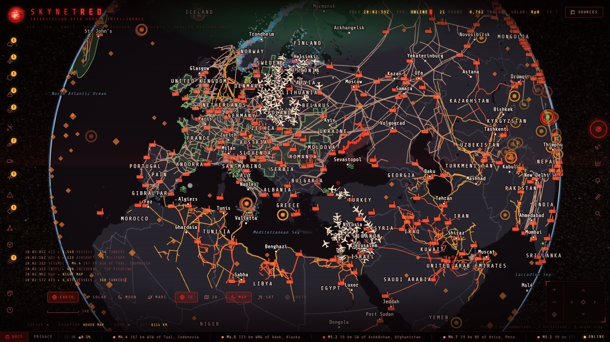
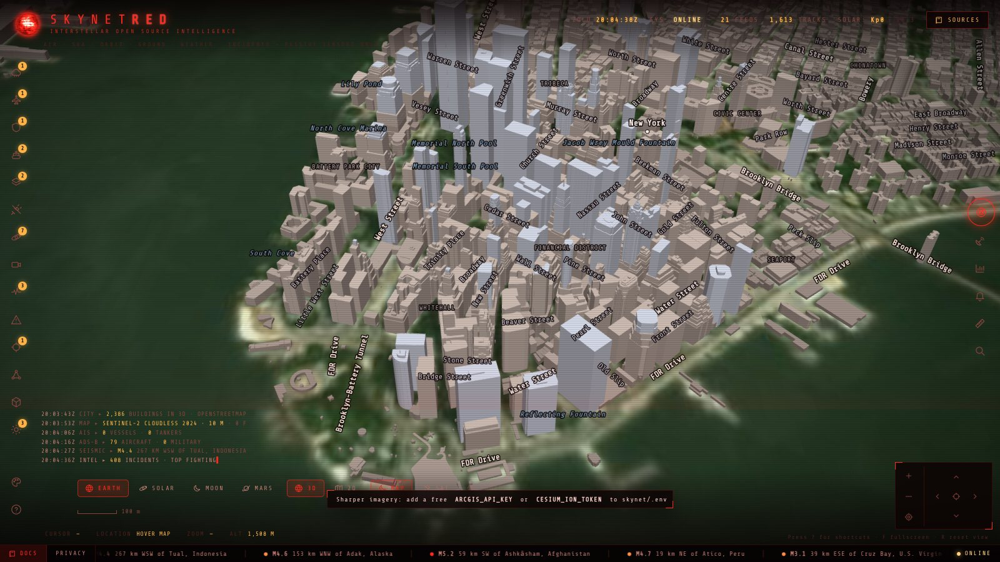
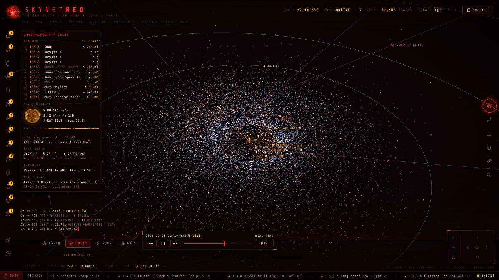
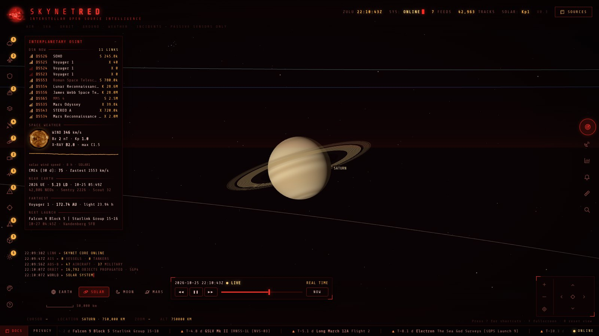
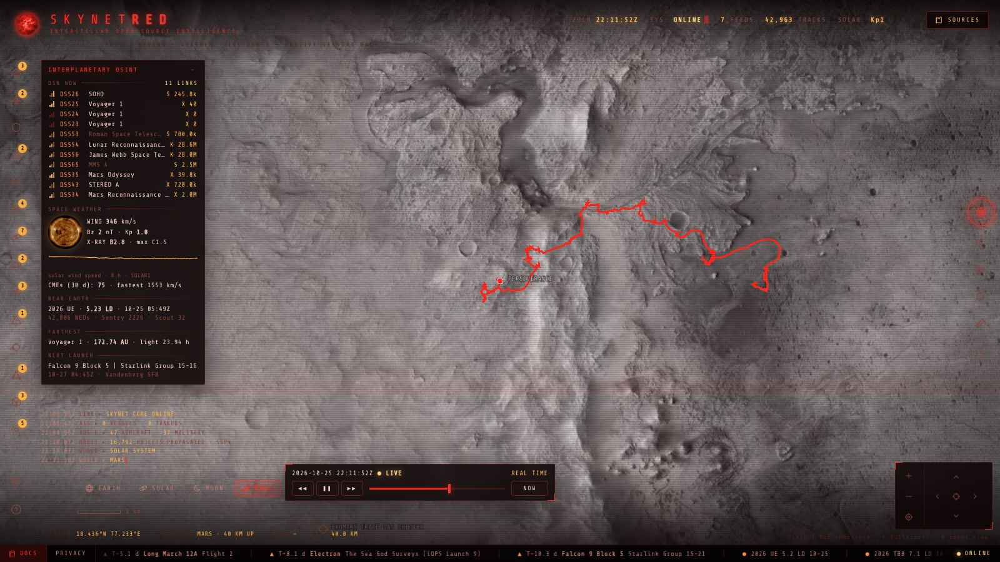

# SKYNETRED · Interstellar Open Source Intelligence

A live open-source intelligence console on a 3D globe. It runs on your own computer, opens in your web browser and
reads public, passive data only. Free for personal, non-commercial use.

## What it shows

- **Air, sea, orbit:** live ships (AIS) and aircraft (ADS-B), tankers, military and private jets, satellites, GPS
  interference worked out from aircraft reports, vessels switching their transponder off (with a free key)
- **Hazards:** earthquakes with shaking maps, disaster alerts (cyclones, floods, droughts, volcanoes), active fires
  (with a free key), fireballs, space weather and aurora
- **Airspace and sea:** SIGMETs, US flight restrictions, navigational warnings
- **Energy:** refineries, LNG and petroleum terminals, offshore platforms, gas flaring, pipelines, the European power
  grid
- **Conflict:** conflict events, the Ukraine front line; incidents from the news; submarine cables; internet outages
  (with a free key)
- **Places:** country, city, town and street names, worldwide street and address search, 3D buildings with photos
  of the building you click, traffic cameras, your own location
- **Space:** the solar system live and to scale, about 40 spacecraft, the Deep Space Network, 43,000 near-Earth
  asteroids, space weather, interstellar visitors, the Moon and Mars up close (more [below](#space))

## Space

Zoom out past the geostationary satellites and the globe hands over to a true-scale 3D model of the solar system;
zoom back in on the Earth to land again. The **EARTH · SOLAR · MOON · MARS** switch jumps straight there.

- **The solar system, live and to scale:** the Sun, the planets, Pluto, the Moon, Jupiter's four large moons and
  Saturn's rings at their real positions for the console's clock, in one view from a planet's surface out to the
  nearest stars. Search finds any planet, moon, spacecraft, asteroid or star by name.
- **About 40 spacecraft:** where each mission is now and the path it has flown, from NASA JPL Horizons — Parker Solar
  Probe, Solar Orbiter, BepiColombo, Juno, Europa Clipper, JUICE, Psyche, Lucy, the James Webb Space Telescope, the
  Mars and Moon orbiters, Artemis II, New Horizons, the Voyagers and the Pioneers. Click one for its distance from the
  Earth and the Sun and how long its radio signal takes to reach us.
- **Deep Space Network:** which dish at Goldstone, Madrid or Canberra is talking to which spacecraft right now, on which
  band and at what data rate, refreshed every 10 seconds. SkynetRED keeps the history, so you can replay it.
- **Near-Earth asteroids:** about 43,000, each flying its own orbit, with every close approach within 0.05 AU over the
  last and next 60 days (in lunar distances), NASA's Sentry impact-risk list and Scout's unconfirmed new finds.
- **Space weather:** the Sun as the SDO spacecraft sees it now, the solar wind's speed and magnetic field, the Kp
  index, X-ray flares and coronal mass ejections, alerts for strong flares and geomagnetic storms, and the aurora
  forecast drawn on the globe.
- **Interstellar:** the heliopause, where the Sun's wind meets interstellar space; the three interstellar visitors
  1I/'Oumuamua, 2I/Borisov and 3I/ATLAS; the nearest stars and the bright-star sky.
- **Time travel:** run the clock forwards or backwards, from real time up to a year per second, anywhere from 1850 to
  2150, and watch the planets, spacecraft and asteroids move.
- **Earth orbit:** thousands of satellites moving live (Starlink and other constellations, military, navigation, Earth
  observation, space stations), meteor fireballs, and the next rocket launches in the ticker.

  
  

- **The Moon and Mars up close:** a globe of each, lit by the real Sun, with NASA imagery — the Lunar Reconnaissance
  Orbiter on the Moon; Viking colour and the 5-metre CTX mosaic on Mars — and the orbiters flying their real tracks.
  On Mars, Perseverance and Curiosity stand where they last stopped, with the whole route they have driven and their
  latest raw images.

## Download

Get the zip for your computer from the [latest release](../../releases/latest), unzip it, and keep the `SkynetRED`
executable and its `app` folder together.

| Computer | File |
| --- | --- |
| Mac with Apple Silicon (M1–M4) | `SkynetRED-<version>-macos-apple-silicon.zip` |
| Mac with Intel | `SkynetRED-<version>-macos-intel.zip` |
| Windows 10/11 (64-bit) | `SkynetRED-<version>-windows-x64.zip` |
| Linux (64-bit) | `SkynetRED-<version>-linux-x64.zip` |

`SHA256SUMS.txt` in the release lists each zip's checksum.

## Start

- **macOS:** double-click `SkynetRED`. The app is not signed with an Apple Developer ID, so the first time macOS says
  it cannot verify the developer: right-click (or Control-click) `SkynetRED` → **Open** → **Open**. If macOS only
  offers *Done*, open **System Settings → Privacy & Security** and click **Open Anyway** next to SkynetRED.
- **Windows:** double-click `SkynetRED.exe`. If SmartScreen warns, click **More info → Run anyway**.
- **Linux:** run `./SkynetRED`.

The console opens at <http://localhost:8787/geo/> in your default browser. Keep the window that opened running; close
it to stop SkynetRED.

## Optional keys

Most layers need nothing. A few free keys switch on more: copy `app/.env.example` to `app/.env` and fill in what you
want — NASA FIRMS (fires), Cloudflare Radar (internet outages), Global Fishing Watch (vessels going dark), Mapillary
(more building photos), aisstream.io (worldwide ships), and ArcGIS, Cesium ion or Google keys for sharper imagery and
photorealistic 3D cities. Keys stay on your computer.

## Privacy

Nothing is sent to the makers of SkynetRED. Your browser and SkynetRED's local server fetch public data directly from
the providers credited in the **Sources** panel. Text you search for goes to Photon (komoot); a building you click is
looked up on OpenStreetMap, Wikidata and Wikimedia Commons. Your location, if you ask for it, stays in your browser.

## Data and licences

Every source is credited in the app's **Sources** panel with its licence; several allow non-commercial use only. The
bundled energy data come from OGIM v3.0 (EDF / MethaneSAT, CC BY 4.0) and the European grid from OpenStreetMap
(© OpenStreetMap contributors, ODbL). Third-party software and data: [THIRD-PARTY-NOTICES.txt](THIRD-PARTY-NOTICES.txt).

The pictures on this page are screenshots of SkynetRED. They show map data © OpenStreetMap contributors
(OpenFreeMap); Sentinel-2 cloudless imagery by EOX IT Services GmbH (contains modified Copernicus Sentinel data 2024);
the Sun from NASA SDO; and on Mars, NASA Viking imagery (NASA Trek) and the CTX mosaic by the Murray Lab, Caltech.

SkynetRED itself: [LICENSE.txt](LICENSE.txt) — free for personal, non-commercial use; the source code is not public.

Information shown comes from third-party public sources and may be incomplete, delayed or wrong. Do not rely on it for
navigation, safety, or decisions with legal or financial consequences. Not affiliated with any of the data providers.
